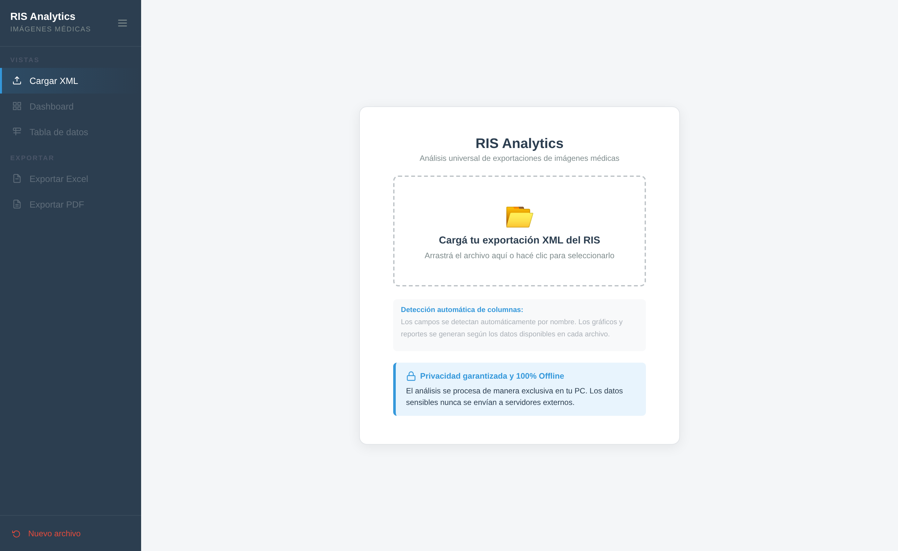
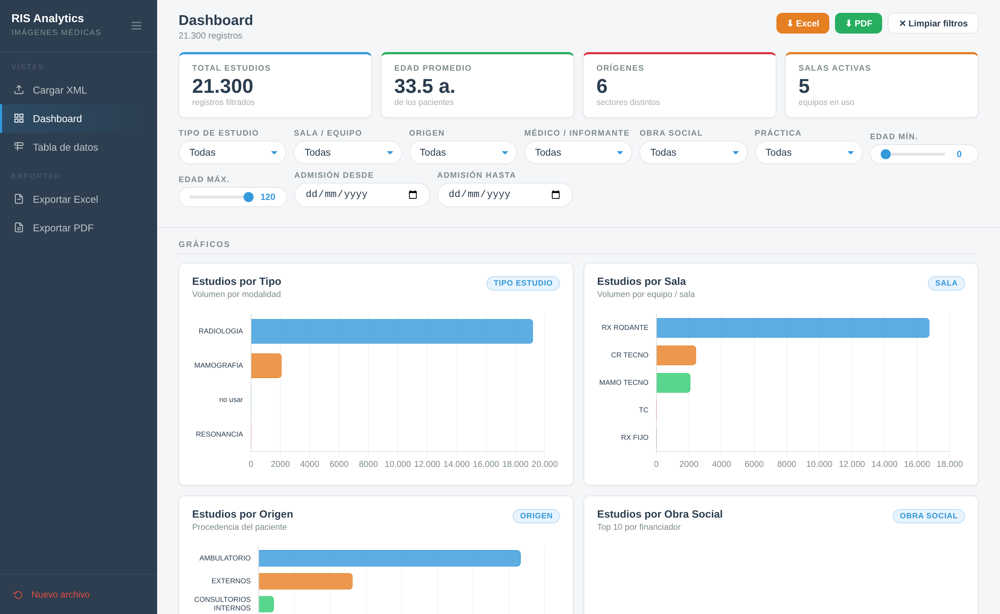
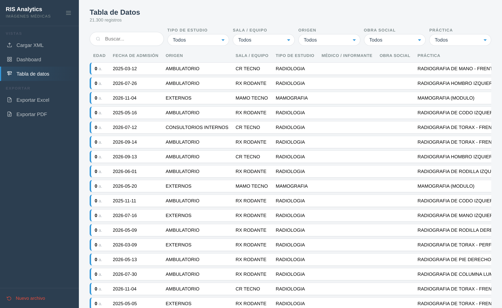
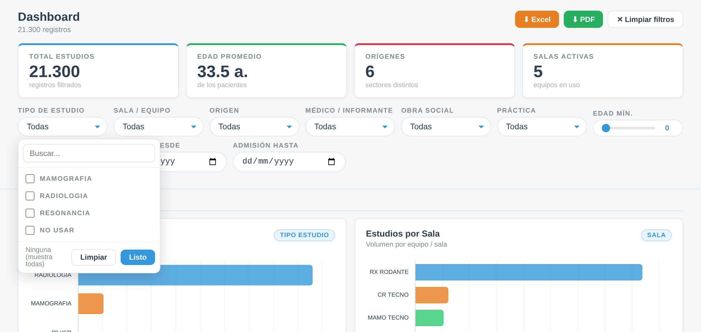
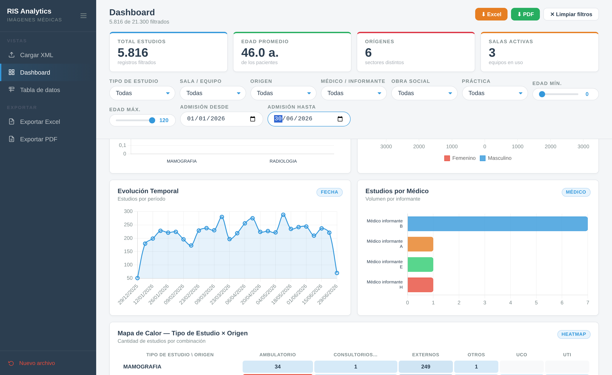
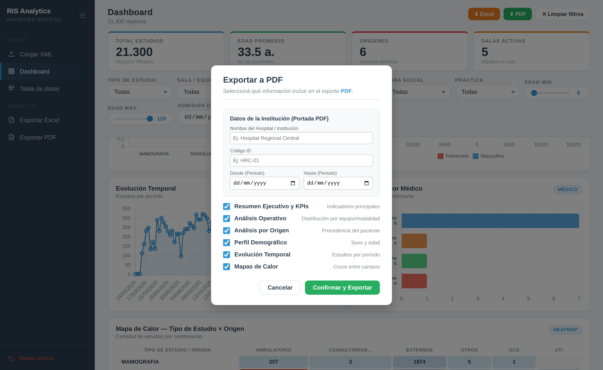

# Guía de uso — RIS Analytics

**Autor:** Bioing. Ernesto Ridel · **Fecha:** 16/11/2026 · **Versión:** RIS Analytics 1.1

Destinada a usuarios de la aplicación y aplicacionistas responsables de su instalación y soporte. Versión para imprimir: [Guia_de_uso_RIS_Analytics_v1.1.pdf](Guia_de_uso_RIS_Analytics_v1.1.pdf).

## 1. Datos a exportar desde Suitestensa

Exportá la consulta de estudios en formato **XML** (hoja de cálculo XML). La app reconoce las columnas por su nombre, así que el orden no importa. Si falta una columna, sus filtros y gráficos simplemente no aparecen.

| Columna en Suitestensa | Para qué se usa | ¿Obligatoria? |
| --- | --- | --- |
| Exam Date - Admitido el | Filtro por fecha de admisión y evolución temporal | Recomendada |
| Mode | Tipo de estudio (modalidad) | Recomendada |
| Origin | Origen del paciente (ambulatorio, internación, etc.) | Recomendada |
| Room | Sala / equipo | Recomendada |
| Description of examination by method | Práctica realizada | Recomendada |
| Médico autor del informe | Médico informante y estudios informados | Opcional |
| Fee/Tariff | Obra social | Opcional |
| Edad - Edad | Edad promedio y pirámide poblacional | Opcional |

Si la exportación trae varias fechas (realización, informe, etc.), la app usa siempre la de admisión. Esperá a que el archivo termine de descargarse antes de cargarlo: un XML incompleto da el error "El XML no es válido".

## 2. Importar y visualizar

1. Abrí **RIS Analytics** desde el acceso directo.
2. En **Cargar XML**, arrastrá el archivo al recuadro o hacé clic para elegirlo.
3. La app abre el **Dashboard** con los datos procesados.

El Dashboard muestra:

- **Indicadores**: total de estudios, edad promedio, orígenes distintos y salas activas.
- **Gráficos**: estudios por tipo, sala, origen, obra social, práctica y médico; totales vs. informados; pirámide poblacional, evolución temporal y mapa de calor.
- **Tabla de datos** (menú izquierdo): el detalle fila por fila, con paginado y filtros propios.

Para analizar otro archivo, usá **Nuevo archivo** (abajo a la izquierda).

## 3. Aplicar filtros

Los filtros están arriba del Dashboard y se combinan entre sí. Indicadores y gráficos se actualizan al instante.

- **Categorías** (tipo de estudio, sala, origen, médico, obra social, práctica): abrí la lista, buscá y marcá uno o varios valores. Sin nada marcado, se muestran todos. **Limpiar** desmarca ese filtro.
- **Edad mín. / máx.**: mové los deslizadores para acotar el rango de edad.
- **Admisión desde / hasta**: elegí las fechas del período. Con un rango activo, los estudios sin fecha quedan afuera. Si se ven en gris, el archivo no trae la columna de admisión.

**Limpiar filtros** (arriba a la derecha) vuelve a mostrar todos los datos.

## 4. Exportar

Las exportaciones incluyen solo los datos que quedan después de aplicar los filtros. Ambas opciones están arriba a la derecha y en el menú **Exportar**.

- **Excel**: marcá qué incluir (datos completos, resumen, totales por sala, origen, etc.) y confirmá. Se descarga un archivo `RIS_Analytics_<fecha>.xlsx` con una hoja por sección.
- **PDF**: completá el nombre y código de la institución y el período para la portada, elegí las secciones y confirmá. La app te pregunta dónde guardar el informe.

## 5. Seguridad y privacidad

RIS Analytics procesa todo en la PC donde está instalada: los datos de los pacientes no se envían a ningún servidor ni se guardan en la aplicación.

- **Procesamiento local**: el XML se lee y analiza en la memoria del equipo. No hay servidores externos, cuentas ni base de datos.
- **Sin almacenamiento**: la app no guarda copias de los datos. Al cerrarla o cargar otro archivo, la información anterior se descarta.
- **Sin transferencia de datos**: al abrirse, la app descarga de internet dos componentes de visualización (gráficos y Excel). Esa descarga no incluye ni envía datos de pacientes.

Por eso distribuir la aplicación no implica compartir datos: cada instalación trabaja solo con los archivos que carga su usuario. Lo único que queda en el equipo son los Excel y PDF que el usuario decide exportar. Su resguardo queda a cargo de la institución, igual que la exportación original de Suitestensa.

## 6. Para aplicacionistas: instalación y soporte

### Requisitos

- Windows 10 u 11 de 64 bits.
- Google Chrome instalado: la app se abre en una ventana de Chrome.
- Conexión a internet al abrir la app, para cargar los componentes de gráficos y Excel.

### Instalación

1. Ejecutá `Instalador_RIS_Analytics_v1.1.exe`. No requiere permisos de administrador.
2. Opcionalmente, marcá la casilla para crear un acceso directo en el escritorio.
3. La app queda en `%LOCALAPPDATA%\Programs\Tecnoimagen\RIS Analytics` (o en Archivos de programa si se instala como administrador) y en el menú Inicio.

### Configuración en Suitestensa

Armá una consulta de estudios con las columnas de la sección 1 y exportala en XML. Conviene guardarla como consulta predefinida para que los usuarios siempre exporten las mismas columnas.

### Problemas frecuentes

| Síntoma | Causa probable | Solución |
| --- | --- | --- |
| "El XML no es válido" | El archivo está incompleto (se cargó antes de terminar de descargarse) o no es una exportación XML. | Esperar a que termine la descarga y volver a cargarlo. El mensaje indica la línea del error. |
| Filtros de admisión en gris | La exportación no incluye la fecha de admisión. | Agregar "Exam Date - Admitido el" a la consulta. |
| Un gráfico aparece vacío | La columna existe pero no tiene valores (por ejemplo, Fee/Tariff vacía → Obra Social). | Revisar que el campo se complete en Suitestensa. |
| No se ven gráficos o falla el Excel | Sin conexión a internet al abrir la app. | Conectar el equipo y volver a abrir la app. |
| La app no abre | Google Chrome no está instalado. | Instalar Google Chrome. |

---

Para regenerar el PDF: editar `guia_de_uso.html` e imprimirlo a PDF (A4) desde Chrome.
